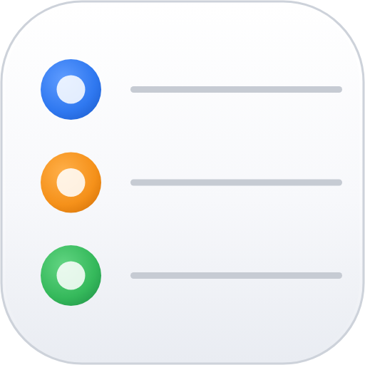
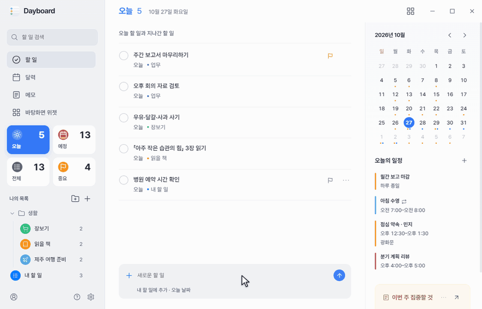
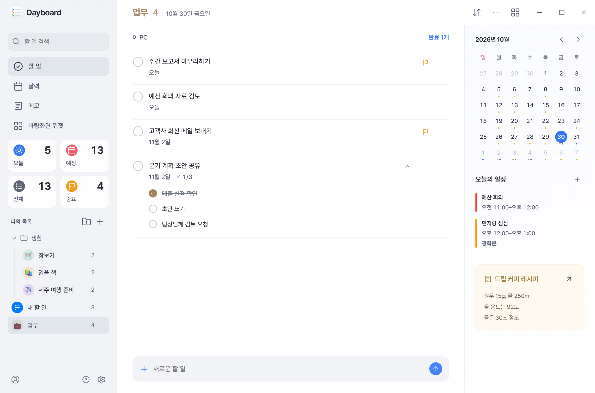
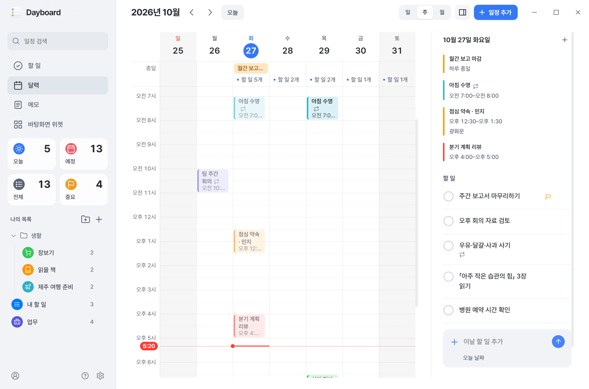
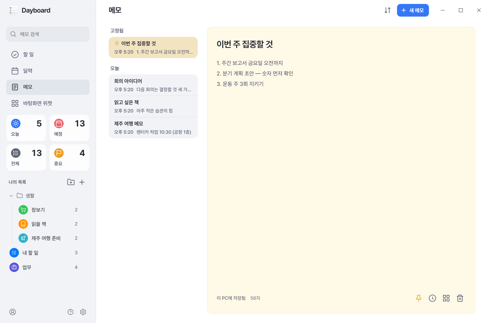
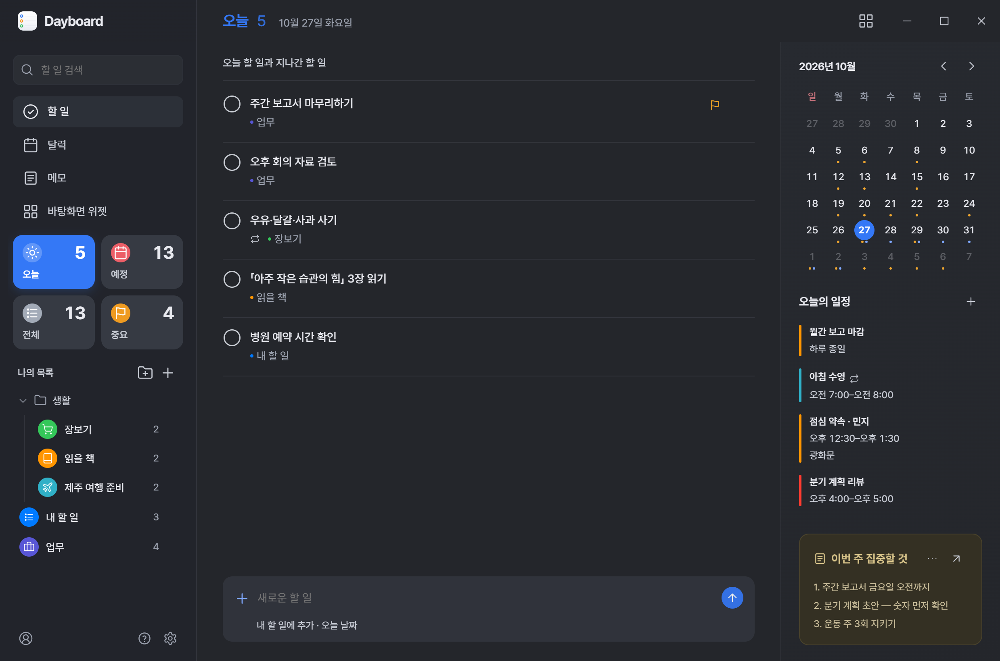
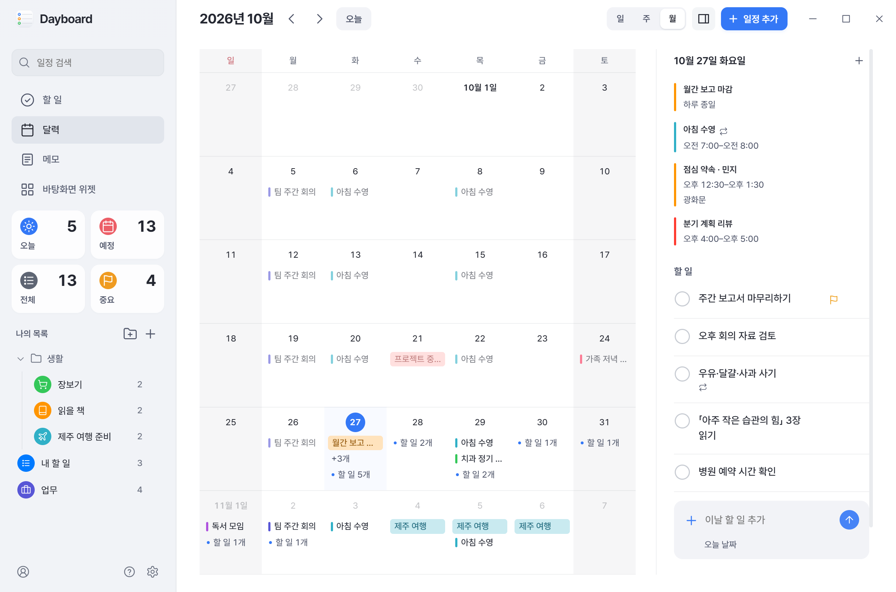
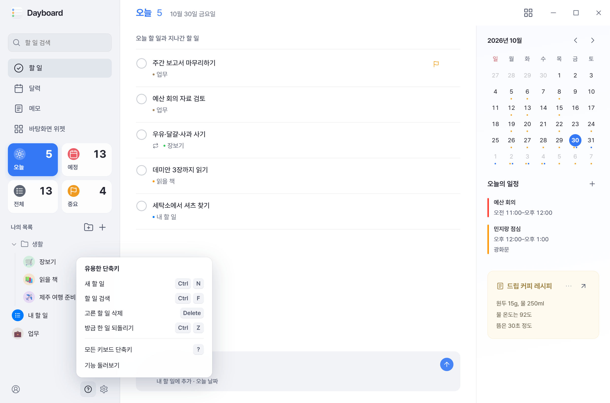
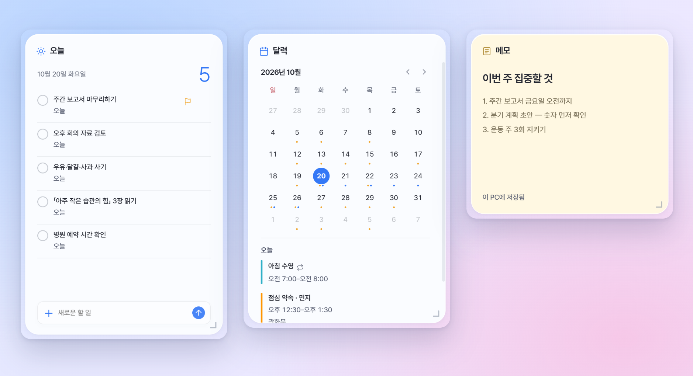

<div align="center">



# Dayboard

Mac·iPhone처럼 깔끔하게, Windows에서 빠릿하게<br>할 일·달력·메모 앱과 바탕화면 위젯

[English](README.md) · **한국어**

[**Windows용 내려받기**](https://github.com/nowsummer/Dayboard/releases/latest) · [소개 페이지](https://nowsummer.github.io/Dayboard/) · [개인정보처리방침](https://nowsummer.github.io/Dayboard/privacy.html)



</div>

## 만든 이유

Mac·iPhone의 미리 알림·캘린더·메모 앱과 위젯은 보기 좋고 쓰기 편해요. Windows에서도 그렇게 쓰고 싶어서 직접 만들었어요. 화면은 깔끔하게, 움직임은 빠릿하게. 이 두 가지를 기준으로 다듬고 있어요.

- **보기 좋게** — 정돈된 화면과 유리처럼 비치는 바탕화면 위젯, 라이트·다크 모드.
- **빠릿하게** — 데이터가 내 PC에 있어서 화면이 바로 열려요.
- **한곳에** — Microsoft·Google·iCloud 계정을 연결하면 다른 PC·iPhone·Android와 동기화돼요. 계정 없이도 쓸 수 있어요.
- **가입·광고 없이** — 서버도, 회원 가입도, 광고도 없어요.

## 기능

| | |
|---|---|
| **할 일** | 오늘·예정·중요 모아보기 · 목록과 그룹 · 반복 할 일과 하위 할 일 · 정렬하거나 끌어서 순서 정하기 · 「내일 오후 3시 회의」처럼 쓰면 날짜가 들어가는 빠른 추가 |
| **달력** | 일·주·월 보기 · 끌어서 옮기고 늘리기 · 옆에 뜨는 카드에서 바로 고치기 · 반복 일정과 알림 · 원하는 날짜로 바로 가기 |
| **메모** | 날짜별 목록 · 맨 위 고정 · 메모 안에서 찾기 · 이전 버전 · Google 계정으로 다른 PC와 동기화 |
| **위젯** | 할 일·달력·메모를 바탕화면에, 리퀴드 글라스 모양으로 |
| **편의** | 검색, 되돌리기·다시 실행, 단축키(<kbd>?</kbd>), 라이트·다크 모드, 한국어·영어 |

## 화면

<table>
  <tr>
    <td width="50%"></td>
    <td width="50%"></td>
  </tr>
  <tr><td align="center">할 일</td><td align="center">달력</td></tr>
  <tr>
    <td></td>
    <td></td>
  </tr>
  <tr><td align="center">메모</td><td align="center">다크 테마</td></tr>
  <tr>
    <td></td>
    <td></td>
  </tr>
  <tr><td align="center">월 보기</td><td align="center">단축키 도움말</td></tr>
</table>

<p align="center"><br>바탕화면 위젯</p>

<sub>화면의 할 일·일정·메모는 예시 데이터예요.</sub>

## 설치

1. [최신 릴리스](https://github.com/nowsummer/Dayboard/releases/latest)에서 `Dayboard-<버전>.exe`를 내려받아 실행하세요. 관리자 권한은 필요 없어요.
2. 설치한 뒤에는 새 버전이 나오면 알아서 내려받아져요. 설정에서 「지금 다시 시작해 적용」을 누르면 새 버전으로 바뀌어요.

> [!NOTE]
> 아직 서명되지 않은 설치 파일이라 Windows 스마트 앱 컨트롤이 처음에 막을 수 있어요. 잠시 뒤 다시 실행해 주세요. Windows x64 전용이에요.

**계정 연결**

- Google 로그인 중 「확인되지 않은 앱」 화면이 나오면 「고급」을 눌러 계속하세요. 개인이 만든 앱이라 Google 검증을 받지 않았어요.
- iCloud는 Apple 계정에서 만든 앱 전용 암호로 연결해요. iCloud 미리 알림은 지원하지 않아요.

## 개인정보

할 일·일정·메모는 내 PC(`%APPDATA%\Dayboard`)에 저장되고, 연결한 계정의 데이터는 내 PC와 그 서비스 사이에서만 오가요. 자세한 내용은 [개인정보처리방침](https://nowsummer.github.io/Dayboard/privacy.html)과 [보안](SECURITY.ko.md)에 있어요.

## 직접 빌드하기

```powershell
git clone https://github.com/nowsummer/Dayboard.git
cd Dayboard
npm ci
npm test
npm start           # 소스로 실행
npm run package     # 앱 번들(설치 파일에 필요)
npm run dist        # 서명 없는 설치 파일(dist\)
```

Windows x64, Git, Node.js 22.12 이상이 필요해요.

- 배포 설치 파일에는 Google 로그인 클라이언트가 들어 있어요. 직접 빌드한 앱은 자기 Google Cloud OAuth 클라이언트를 입력하라고 안내해요(`assets/google-oauth.example.json` 참고).
- 직접 빌드한 앱도 공식 릴리스를 내려받아요. 그대로 쓰려면 설정의 「새 버전 자동 확인」을 끄세요.

## 라이선스

[MIT](LICENSE). 글꼴과 서비스 로고는 각자의 라이선스를 따라요([안내](docs/licenses/THIRD-PARTY.txt)). Microsoft·Google·Apple과 관계없는 개인 프로젝트예요.
