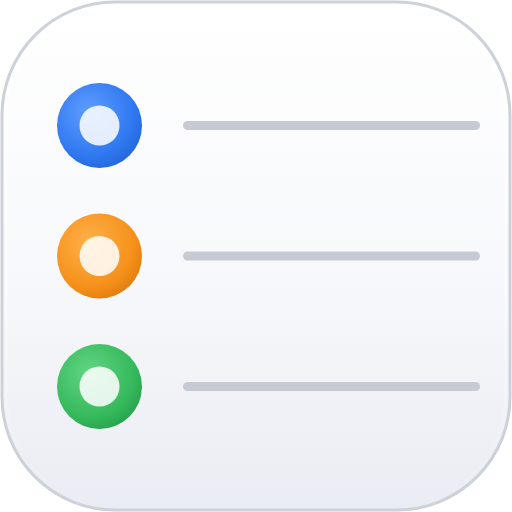
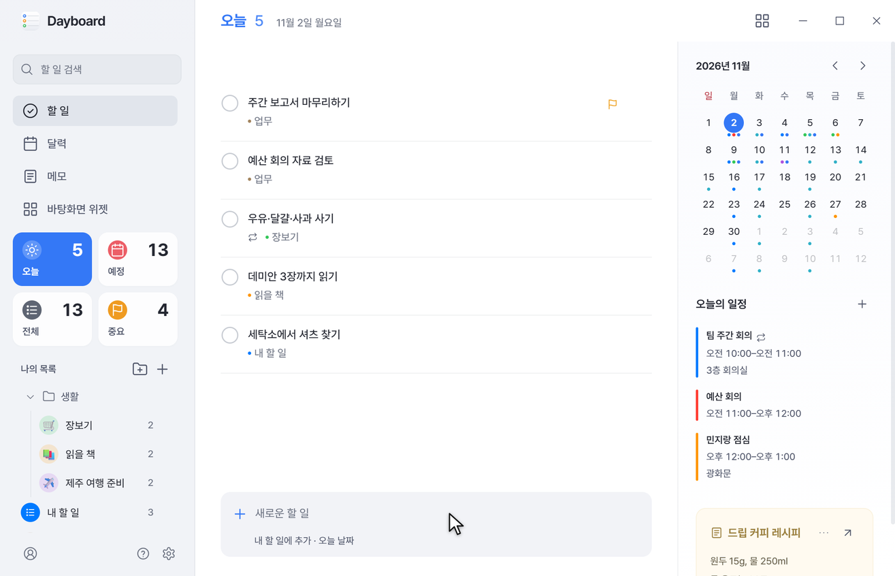
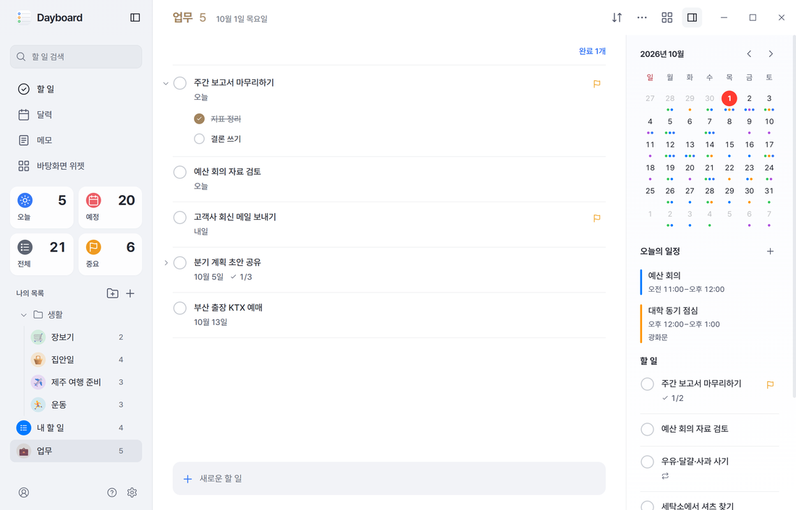
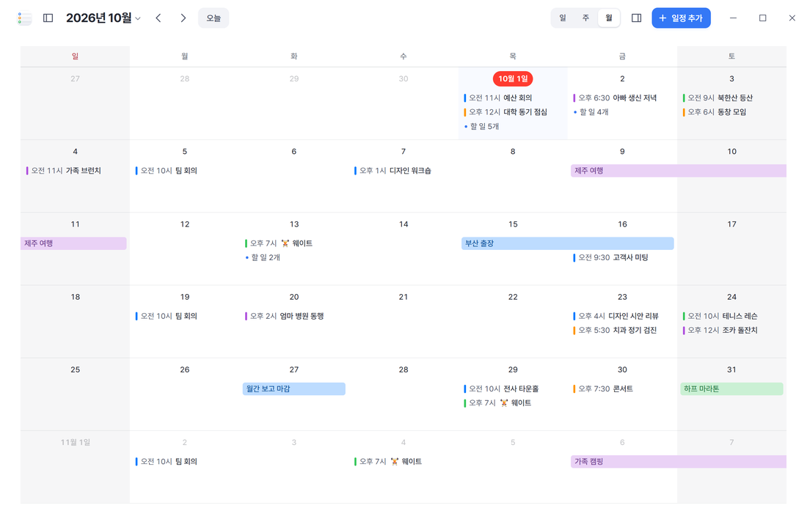
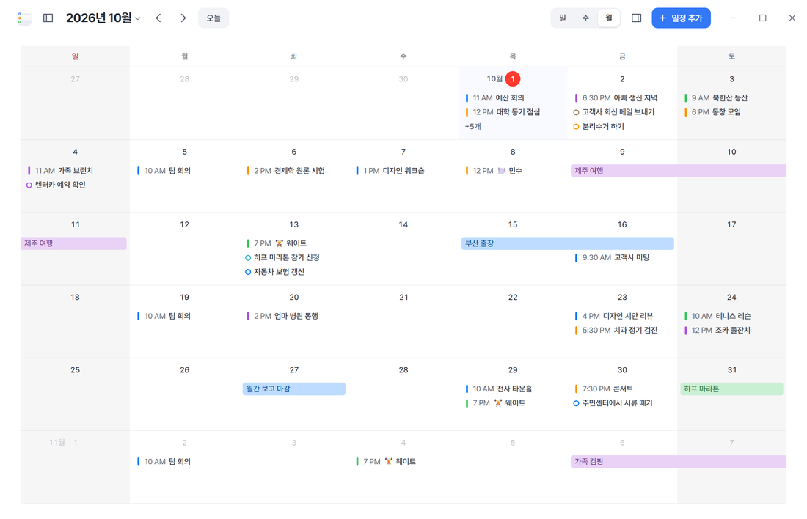
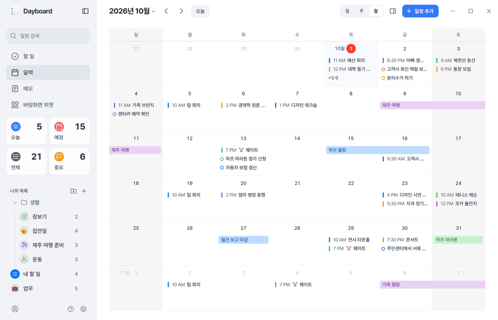
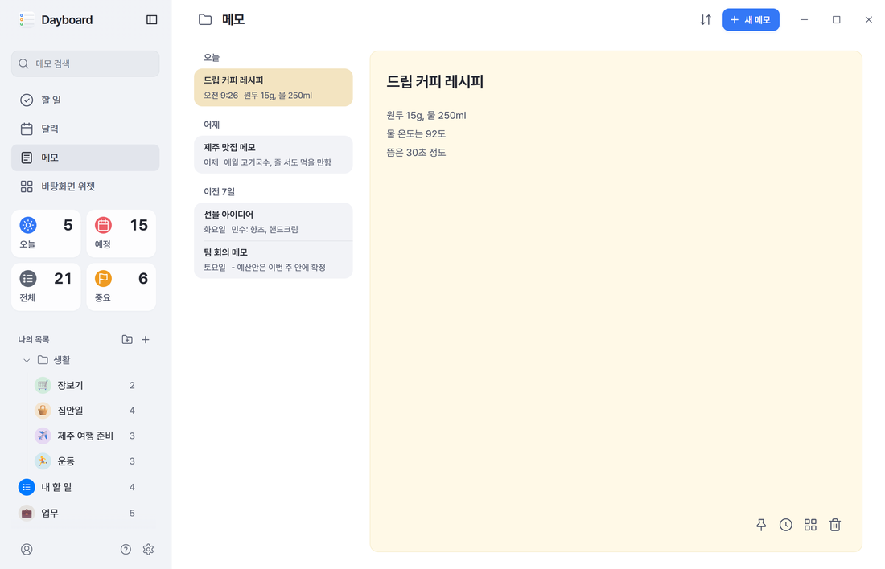
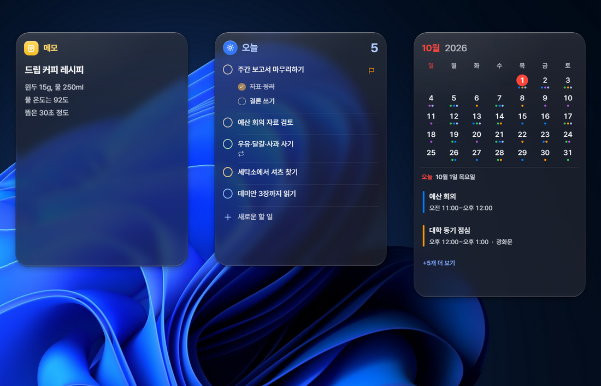

<p align="center"><a href="README.md">English</a> · <b>한국어</b></p>

<div align="center">



# Dayboard

**할 일과 일정을 현황판처럼 한눈에 보는 Windows 앱**<br>
Mac·iPhone처럼 깔끔한 화면에서, 오늘 할 일과 일정을 한곳에 모아 봐요.

[**Windows용 내려받기**](https://github.com/nowsummer/Dayboard/releases/latest)



</div>

## 할 일: 해야 할 일을 놓치지 않게

적어 두고, 끝나면 동그라미만 누르면 돼요.

- 날짜를 정하면 오늘·예정으로 저절로 모이고, 깃발을 누르면 중요로 모여요
- 목록과 그룹으로 나누고, 큰 일은 하위 할 일로 쪼개요
- 날짜와 알림, 반복을 걸어 둘 수 있어요
- 날짜가 있는 할 일은 달력에도 일정과 함께 보여요

<p align="center"></p>

## 달력: 떠오르는 대로 쓰면 일정이 돼요

날짜를 찾아 누르고, 시간을 고르고, 장소를 따로 넣을 필요 없어요. 생각나는 대로 쭉 쓰면 Dayboard가 날짜·시간·제목을 알아보고 달력에 저장해 줘요. 장소는 쉼표 뒤에 적으면 돼요.

`10/6, 오후 2시~3시, 경제학 원론 시험, 대강의실`<br>
→ 10월 6일 오후 2시~3시 · 경제학 원론 시험 · 대강의실

<p align="center"></p>

일정은 끌어서 옮기고, 늘려서 시간을 바꿔요.

<p align="center"></p>

### 자주 쓰는 일정: 매번 같은 일정은 낱말 하나로

점심 약속이나 퇴근 후 운동처럼 시간이 늘 같은 일정이 있어요. 낱말 하나에 시간과 아이콘을 한 번 정해 두면, 다음부터는 그 낱말만 쓰면 정해 둔 대로 저장돼요.

`점심 민수`<br>
→ 🍽️ 민수 · 낮 12시~1시

`웨이트`<br>
→ 🏋️ 웨이트 · 저녁 7시~8시 반

<p align="center"></p>

## 메모: 가볍게 적고, 바로 찾아요

와이파이 비밀번호나 프린터 IP 주소처럼, 가끔 필요한데 막상 찾으면 없는 것들이 있어요. 적어 둔 포스트잇은 어디 뒀는지 모르겠고, 무거운 노트 앱은 켜고 찾는 데 한참 걸리죠. Dayboard 메모는 가볍게 적어 두고, 검색 한 번으로 바로 찾을 수 있어요. 자주 보는 메모는 바탕화면에 올려 둘 수 있어요.

<p align="center"></p>

## 위젯: 앱을 열지 않아도 바탕화면에서

할 일과 달력, 메모를 바탕화면에 올려 두고 바로 확인해요. 뒤 배경이 은은하게 비치는 리퀴드 글라스 디자인이고, 투명도도 원하는 만큼 조절돼요.

<p align="center"></p>

## 계정 연결

Microsoft나 Google 계정을 연결하면 할 일과 달력이 휴대폰이나 다른 PC와 맞춰지고, 메모도 PC끼리 맞출 수 있어요. iCloud는 달력만 연결돼요. 계정 없이 이 PC에서만 써도 돼요.

## 내려받기

[**Windows용 내려받기**](https://github.com/nowsummer/Dayboard/releases/latest)

아직 코드 서명이 없어서 Windows가 설치를 경고하거나 막을 수 있어요.

---

<details>
<summary>소스에서 직접 빌드하기</summary>

```powershell
git clone https://github.com/nowsummer/Dayboard.git
cd Dayboard
npm ci
npm test
npm start           # 소스로 실행
npm run package     # 앱 번들(설치 파일에 필요)
npm run dist        # 서명 없는 설치 파일(dist 폴더)
```

Windows x64, Git, Node.js 22.12 이상이 필요해요.

- 배포 설치 파일에는 Google 로그인 클라이언트가 들어 있어요. 직접 빌드한 앱은 자기 Google Cloud OAuth 클라이언트를 입력하라고 안내해요(`assets/google-oauth.example.json` 참고).
- 직접 빌드한 앱도 공식 릴리스를 내려받아요. 그대로 쓰려면 설정의 「새 버전 자동 확인」을 끄세요.

</details>

문의 nowsummer.apps@gmail.com · [보안](SECURITY.ko.md) · [MIT 라이선스](LICENSE)([글꼴·서비스 로고 안내](docs/licenses/THIRD-PARTY.txt))<br>
Microsoft·Google·Apple과 관계없는 개인 프로젝트예요.

[개인정보처리방침](https://nowsummer.github.io/Dayboard/privacy.html)
