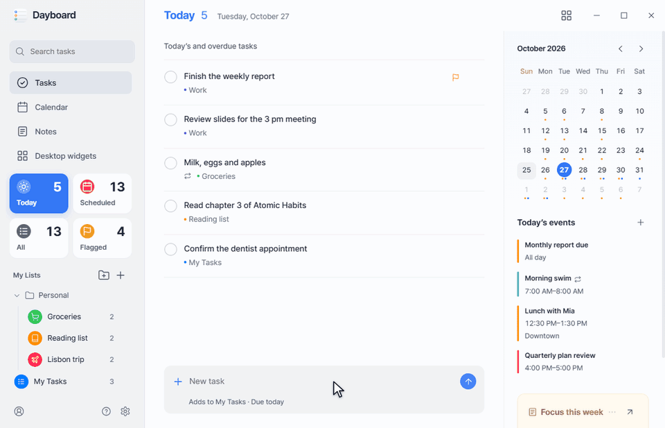
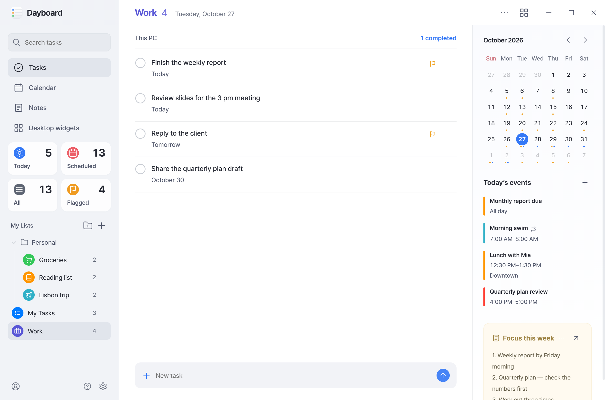
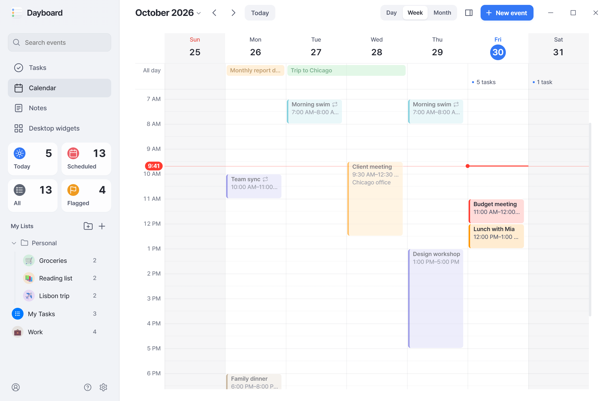
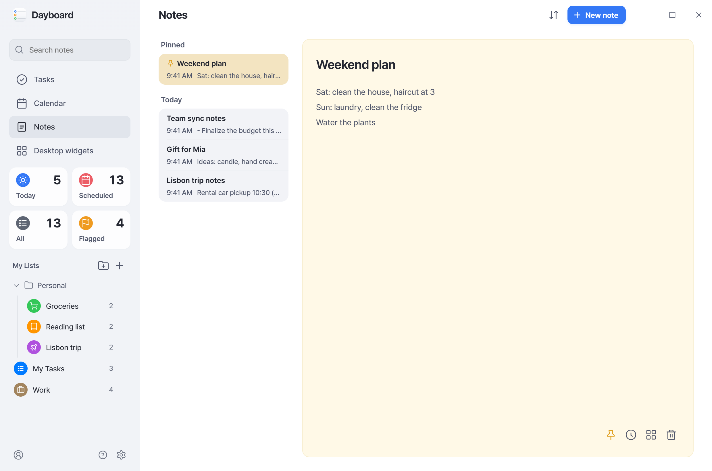
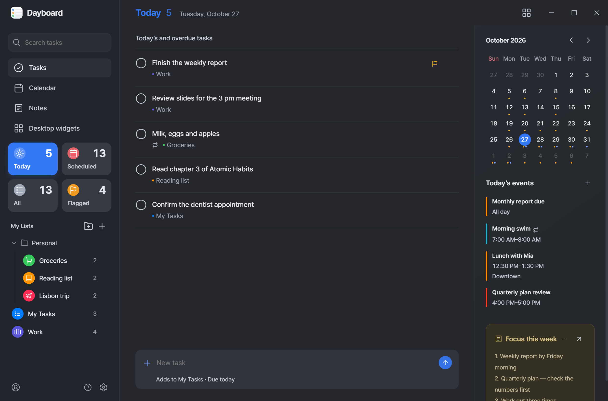
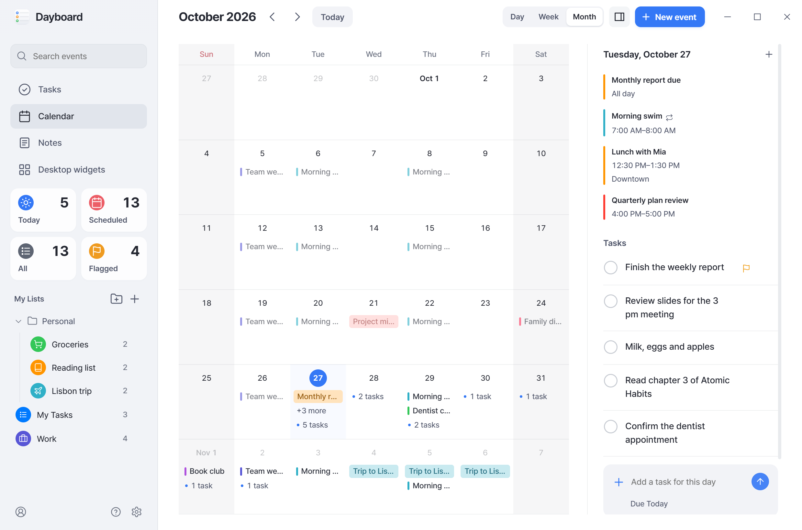
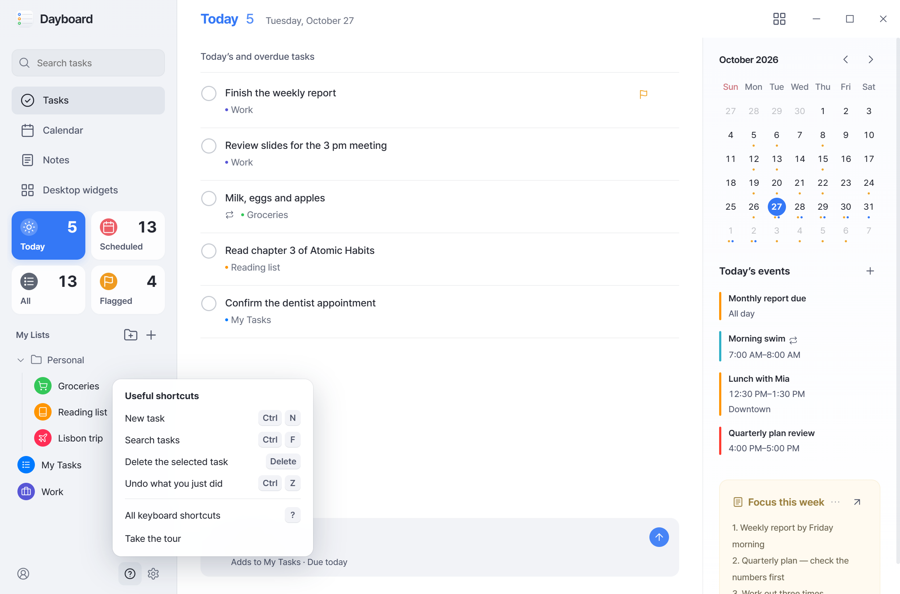
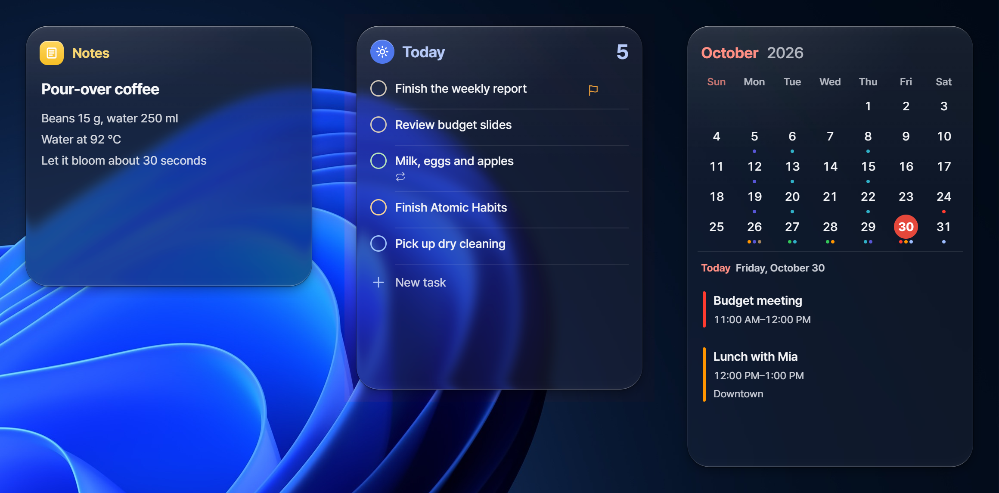

<div align="center">


# Dayboard

Clean like a Mac or iPhone. Quick on Windows.<br>Tasks, calendar and notes, with desktop widgets.

**English** · [한국어](README.ko.md)

[**Download for Windows**](https://github.com/nowsummer/Dayboard/releases/latest) · [Website](https://nowsummer.github.io/Dayboard/en/) · [Privacy](https://nowsummer.github.io/Dayboard/en/privacy.html)



</div>

## Why

The Reminders, Calendar and Notes apps on a Mac or iPhone, and their widgets, look good and are a pleasure to use. I wanted the same on Windows, so I built it. Two rules from the start: keep it clean, keep it quick.

- **Clean** — a tidy layout, glassy desktop widgets, light and dark.
- **Quick** — your data is kept on your PC, so screens open without waiting. Changes from your other devices come in on their own.
- **All in one place** — Microsoft To Do and Outlook, Google Tasks and Calendar, iCloud Calendar, or no account at all.
- **Private** — no server, no sign-up, no ads.

## Features

| | |
|---|---|
| **Tasks** | Today, Scheduled and Flagged · lists and groups · quick add that understands "tomorrow 3pm" |
| **Calendar** | Day, week and month · drag to move or resize · edit in a card beside the event · repeating events |
| **Notes** | Grouped by date · pinning · find · earlier versions · kept in step across your PCs with Google |
| **Widgets** | Tasks, calendar and notes on the desktop, in Liquid Glass style |
| **Everyday** | Search, undo and redo, shortcuts (press <kbd>?</kbd>), light and dark, English and Korean |

## Screenshots

<table>
  <tr>
    <td width="50%"></td>
    <td width="50%"></td>
  </tr>
  <tr><td align="center">Tasks</td><td align="center">Calendar</td></tr>
  <tr>
    <td></td>
    <td></td>
  </tr>
  <tr><td align="center">Notes</td><td align="center">Dark theme</td></tr>
  <tr>
    <td></td>
    <td></td>
  </tr>
  <tr><td align="center">Month view</td><td align="center">Shortcut help</td></tr>
</table>

<p align="center"><br>Desktop widgets</p>

<sub>Screenshots use sample data.</sub>

## Install

1. Download `Dayboard-<version>.exe` from the [latest release](https://github.com/nowsummer/Dayboard/releases/latest) and run it. No admin rights needed.
2. New versions download in the background and install when you choose **Restart now to update**.

> [!NOTE]
> The installer isn't signed yet, so Windows Smart App Control may block it at first. Wait a moment and run it again. Windows x64 only.

**Connecting accounts**

- Google may say it hasn't verified the app. Choose **Advanced** to continue — it's a personal project.
- iCloud connects with an app-specific password from your Apple Account. iCloud Reminders aren't supported.

## Privacy

Tasks, events and notes stay on your PC (`%APPDATA%\Dayboard`), and data from connected accounts moves only between your PC and that service. Details: [Privacy policy](https://nowsummer.github.io/Dayboard/en/privacy.html) · [Security](SECURITY.md).

## Build from source

```powershell
git clone https://github.com/nowsummer/Dayboard.git
cd Dayboard
npm ci
npm test
npm start           # run from source
npm run package     # app bundle (needed by dist)
npm run dist        # unsigned installer in dist\
```

Needs Windows x64, Git and Node.js 22.12 or later.

- Official installers include the Google sign-in client. Your own build asks for your own Google Cloud OAuth client (see `assets/google-oauth.example.json`).
- Your own build still offers official releases. Turn off **Check for new versions automatically** to stay on it.

## License

[MIT](LICENSE). Fonts and service logos keep their own licenses ([notices](docs/licenses/THIRD-PARTY.txt)). Dayboard isn't affiliated with Microsoft, Google or Apple.
