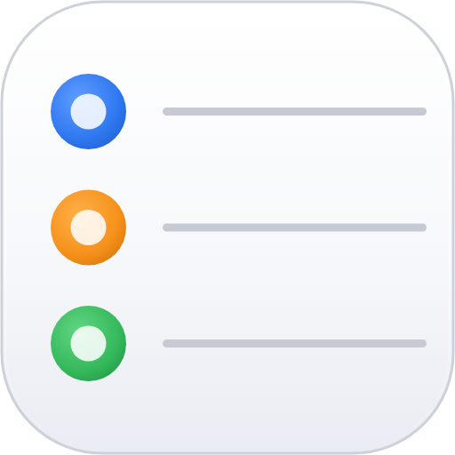
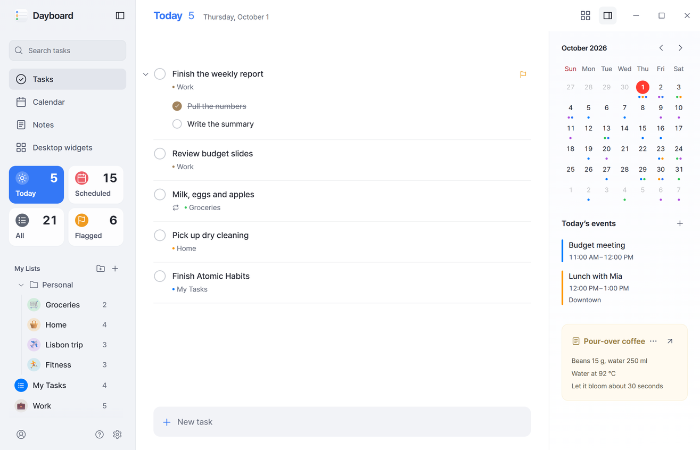
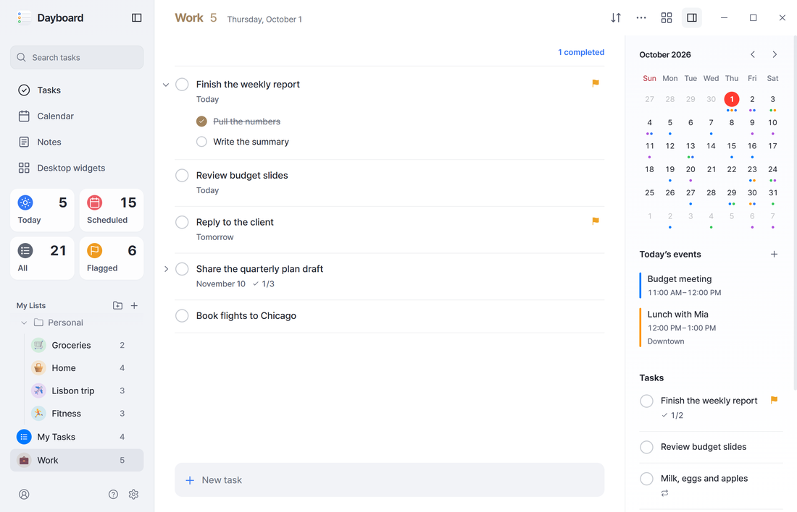
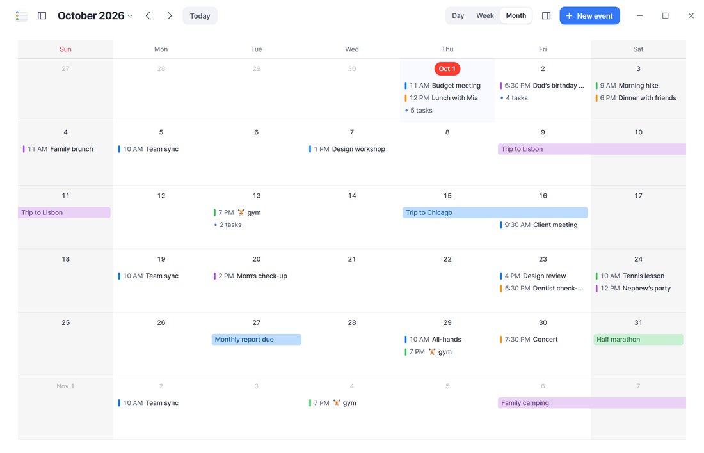
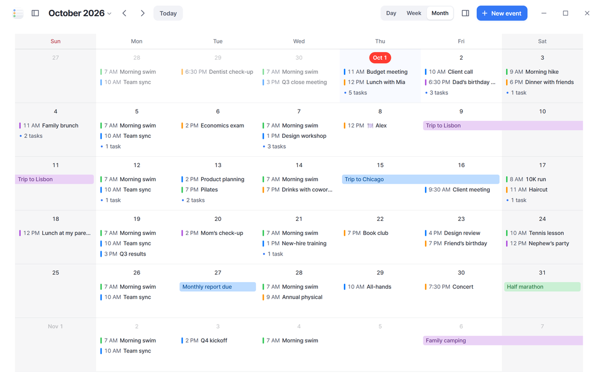
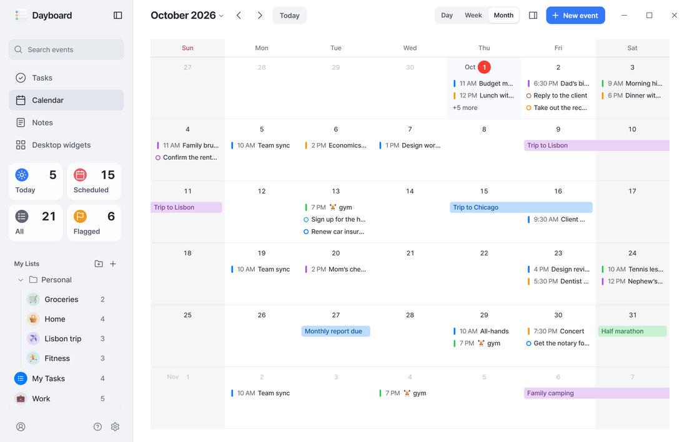
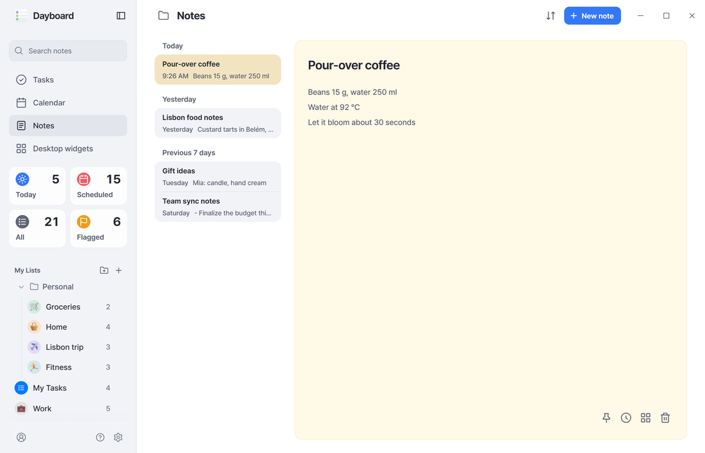
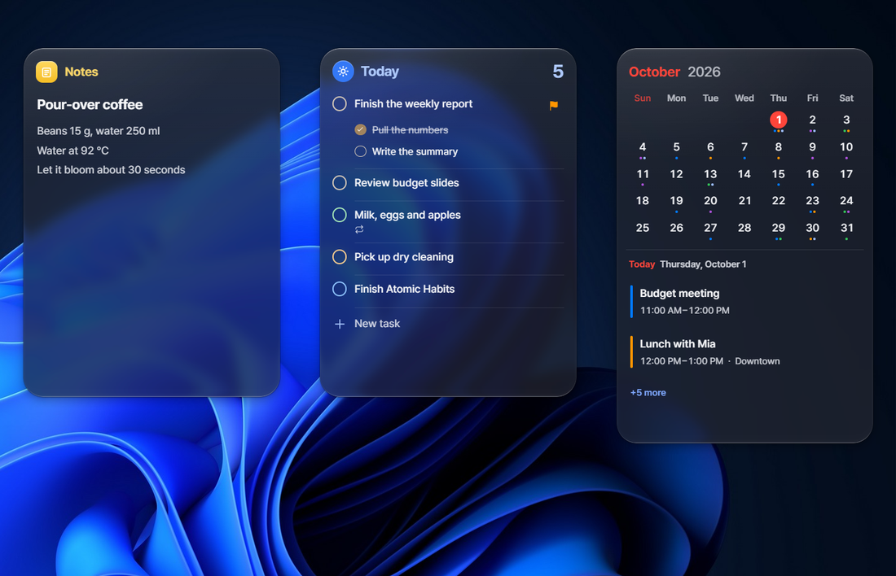

<p align="center"><b>English</b> · <a href="README.ko.md">한국어</a></p>

<div align="center">



# Dayboard

**Your tasks and calendar on one board, at a glance. For Windows.**<br>
A clean, Mac- and iPhone-style look for everything on your plate today.

[**Download for Windows**](https://github.com/nowsummer/Dayboard/releases/latest)



</div>

## Tasks: nothing slips through

Write it down, then tick it off when it's done.

- Set a date and it sorts itself into Today or Scheduled. Flag it to send it to Flagged
- Sort tasks into lists and groups, and break big ones into subtasks
- Add dates, reminders and repeats

<p align="center"></p>

## Calendar: just type what's on your mind

No hunting for the day, picking a time or filling in the place. Type it in one line and Dayboard works out the date, time and title, then puts it on your calendar. Add the place after a comma.

`Oct 6, 2–3pm, Economics exam, Main Hall`<br>
→ Oct 6, 2:00–3:00 PM · Economics exam · Main Hall

<p align="center"></p>

Drag to move an event, stretch to change its time.

<p align="center"></p>

### Quick events: one word for the plans you repeat

Lunch with a friend, the gym after work: some plans always happen at the same hours. Set up a word once with its time and icon, and from then on that word is all you need.

`lunch Alex`<br>
→ 🍽️ Alex · 12:00–1:00 PM

`gym`<br>
→ 🏋️ gym · 7:00–8:30 PM

<p align="center"></p>

## Notes: jot it down, find it fast

The Wi-Fi password. The office printer's IP address. You only need them now and then, the sticky note has vanished, and opening a heavy notes app to dig for them takes forever. Dayboard's notes are quick to jot down and one search away. Keep the ones you use most on your desktop.

<p align="center"></p>

## Widgets: see it all without opening the app

Keep your tasks, calendar and notes on the desktop. The Liquid Glass-style design lets your wallpaper show through, and you choose how clear it is.

<p align="center"></p>

## Accounts

Connect a Microsoft or Google account to keep your tasks and calendars in sync with your phone and other PCs, and your notes between PCs. iCloud connects calendars only. Or use it on this PC alone, no account needed.

## Download

[**Download for Windows**](https://github.com/nowsummer/Dayboard/releases/latest)

Dayboard isn't code-signed yet, so Windows may warn you about the installer or block it.

---

<details>
<summary>Build from source</summary>

```powershell
git clone https://github.com/nowsummer/Dayboard.git
cd Dayboard
npm ci
npm test
npm start           # run from source
npm run package     # app bundle (needed by dist)
npm run dist        # unsigned installer in the dist folder
```

Needs Windows x64, Git and Node.js 22.12 or later.

- Official installers include the Google sign-in client. Your own build asks for your own Google Cloud OAuth client (see `assets/google-oauth.example.json`).
- Your own build still offers official releases. Turn off **Check for new versions automatically** to stay on it.

</details>

Contact nowsummer.apps@gmail.com · [Security](SECURITY.md) · [MIT License](LICENSE) ([fonts and service logos](docs/licenses/THIRD-PARTY.txt))<br>
Dayboard isn't affiliated with Microsoft, Google or Apple.

[Privacy Policy](https://nowsummer.github.io/Dayboard/en/privacy.html)
