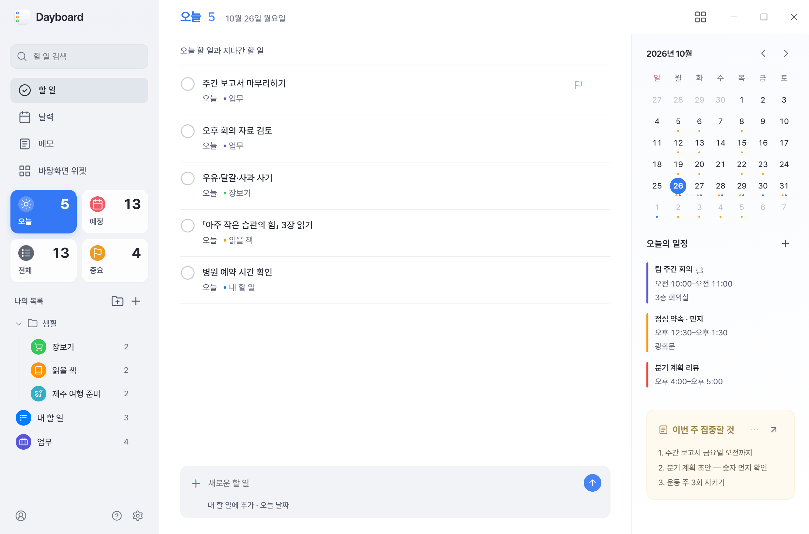

# Dayboard

**Windows 바탕화면에 두고 쓰는 할 일·달력·메모 앱입니다.**
Microsoft To Do·Outlook 달력, Google Tasks·Google 캘린더, iCloud 달력을 한 화면에 모으고, 할 일·달력·메모를 바탕화면 위젯으로 띄워 둘 수 있습니다. 서버나 회원 가입이 없고, 데이터는 사용자의 PC에만 저장됩니다.

## 설치

1. [최신 릴리스](https://github.com/nowsummer/dayboard/releases/latest)에서 `Dayboard-<버전>.exe`를 내려받아 실행합니다.
2. 관리자 권한 없이 지금 쓰는 Windows 계정에 설치되고 바로 시작됩니다.
3. 새 버전은 Dayboard가 스스로 확인해 내려받아 두고, 설정에서 「지금 다시 시작해 적용」을 누를 때만 설치합니다.

- 서명되지 않은 새 설치 파일이라 Windows 스마트 앱 컨트롤이 몇 분 동안 실행을 막을 수 있습니다. 잠시 뒤 다시 실행하세요.
- 버전별 변경 내용은 [릴리스](https://github.com/nowsummer/dayboard/releases)에 있습니다. 앱 설정의 「업데이트 기록」도 이 페이지를 엽니다.

## 주요 기능

- **할 일**: 오늘·예정·전체·중요 모아보기, 목록별 색·아이콘·그룹, 드래그로 순서 정리, 알림 시각, "내일 치과"처럼 날짜를 넣어 바로 추가
- **달력**: 월 달력과 그날의 일정·할 일을 함께 보는 옆 패널, 반복 일정, 일정별 색
- **메모**: 짧은 기록을 최근 순으로 정리
- **바탕화면 위젯**: 할 일·달력·메모를 바탕화면에 두거나 항상 위에 표시, 유리 효과(투명~불투명) 조절
- **편의 기능**: 전체 검색(Ctrl+K), 새 항목 추가(Ctrl+N), 라이트·다크 테마, 한국어·영어, 오전·오후 또는 24시간 표시

## 연결할 수 있는 계정

| 계정 | 할 일 | 달력 |
|---|---|---|
| Microsoft (To Do·Outlook) | 보기·추가·수정·완료·삭제 | 보기·추가·수정·삭제 |
| Google (Tasks·캘린더) | 보기·추가·수정·완료·삭제 | 보기·추가·수정·삭제 |
| Apple iCloud | 지원하지 않음 (미리 알림 연동 없음) | 보기·추가·수정·삭제 |
| 계정 없이 (이 PC) | 보기·추가·수정·완료·삭제 | 보기·추가·수정·삭제 |

- 달력에 일정을 적으려면 로그인할 때 달력 쓰기 권한에 동의해야 합니다. 공휴일 달력처럼 읽기만 허용된 달력에는 적을 수 없습니다.
- Google 로그인 중 「확인되지 않은 앱」 화면이 나오면 「고급」을 눌러 계속하세요. 개인이 만든 앱이라 Google 검증을 받지 않았습니다.
- iCloud는 Apple 계정에서 만든 앱 전용 암호로 연결합니다.

## 화면

### 달력

### 바탕화면 위젯

### 메모

### 다크 테마

> 화면의 할 일·일정·메모는 모두 예시 데이터입니다.

## 개인정보

- Dayboard는 서버를 운영하지 않습니다. 할 일·일정·메모는 PC의 `%APPDATA%\Dayboard` 폴더에 저장되고, 로그인 정보는 Windows 암호화로 보호합니다.
- 연결한 계정의 데이터는 각 서비스(Microsoft·Google·Apple)와 PC 사이에서만 오가며, 개발자나 제3자에게 보내지 않습니다. 업데이트 확인은 GitHub에서 새 버전 정보만 받아 옵니다.
- 앱을 제거해도 데이터 폴더는 남습니다. 모두 지우려면 이 폴더를 지우세요.
- 자세한 내용은 [개인정보처리방침](https://nowsummer.github.io/dayboard/privacy.html)을 참고하세요.

## 이 저장소

Dayboard의 [소개 페이지](https://nowsummer.github.io/dayboard/), [개인정보처리방침](https://nowsummer.github.io/dayboard/privacy.html), 설치 파일과 업데이트 기록이 있는 [릴리스](https://github.com/nowsummer/dayboard/releases)를 제공합니다. 앱 소스 코드는 포함하지 않습니다.

---

English

**Dayboard** is a personal Windows desktop app for tasks, calendar and notes. It brings Microsoft To Do / Outlook calendar, Google Tasks / Google Calendar and iCloud calendar into one window, lets you add, edit and delete events in those calendars, and can pin tasks, calendar and notes to the desktop as widgets. iCloud Reminders are not supported.

To install, download `Dayboard-<version>.exe` from the [latest release](https://github.com/nowsummer/dayboard/releases/latest) and run it. It installs for the current Windows user without admin rights. New versions are downloaded in the background and installed only when you click "Restart now to update" in Settings. Windows Smart App Control may block a new unsigned installer for a few minutes.

There is no server and no sign-up: data stays in `%APPDATA%\Dayboard` on your PC, and sign-in tokens are protected by Windows encryption. See the [privacy policy](https://nowsummer.github.io/dayboard/privacy.html). The screenshots use sample data. This repository hosts the web pages and releases; it does not contain the app source.

